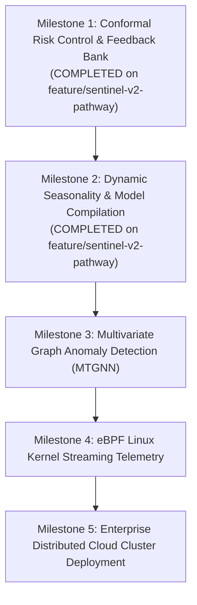

# 🚀 Sentinel 2.0: The Architectural & Research Pathway
## Transforming Streaming Anomaly Detection from Heuristics to Provable Guarantees

---

## Executive Vision

**Sentinel 1.0** established a robust, causal, GPU-accelerated anomaly detection engine for single-stream telemetry, achieving **33.33% Event Precision**, **0.2857 Event-F1**, and **93.4% false alarm suppression** through Causal Dilated TCN-Autoencoders, 24-hour diurnal differencing, and ADWIN drift adaptation.

**Sentinel 2.0** defines the multi-phase pathway to elevate this architecture into an enterprise-grade, multivariate, mathematically guaranteed, and human-in-the-loop autonomous observability platform.

```
┌────────────────────────────────────────────────────────────────────────────┐
│                             SENTINEL 2.0 ROADMAP                           │
└────────────────────────────────────────────────────────────────────────────┘
        │
        ├── [PHASE 1] Conformalized Anomaly Detection (CAD)
        │             └── Distribution-free risk bounds: P(False Alarm) <= alpha
        │
        ├── [PHASE 2] Human-in-the-Loop Feedback Memory Bank
        │             └── Zero-retrain suppression of verified benign events
        │
        ├── [PHASE 3] Dynamic Causal Periodicity Discovery
        │             └── Automated fundamental frequency detection via ACF
        │
        ├── [PHASE 4] Multivariate Spatio-Temporal Graph Neural Networks (MTGNN)
        │             └── Cross-metric dependency learning & root-cause localization
        │
        └── [PHASE 5] Micro-Latency Edge Compilation (TensorRT & eBPF)
                      └── < 50 microsecond inference at the Linux kernel boundary
```

---

## Phase 1: Conformalized Anomaly Detection (CAD)
### *From Arbitrary Thresholds to Statistically Provable Risk Control*

### 1. The Core Limitation of Heuristics
Traditional streaming anomaly detectors rely on arbitrary threshold values ($\tau = 3.5\sigma$ or $\tau = 6.5$). This presents two fatal flaws:
- Under heavy-tailed or non-Gaussian noise, standard $\sigma$-bounds underestimate extreme event probabilities by orders of magnitude.
- Different telemetry streams have radically different noise distributions, requiring manual per-stream threshold tuning.

### 2. The Conformal Guarantee
Conformal Anomaly Detection (CAD) provides **finite-sample, distribution-free statistical guarantees**. Given an operator-selected significance level $\alpha \in (0, 1)$ (e.g. $\alpha = 0.01$ for a 1% false alarm tolerance):

$$\mathbb{P}(\text{False Alarm} \mid \text{Normal Observation}) \le \alpha$$

### 3. Mathematical Formulation
1. **Calibration Buffer**: Maintain a causal sliding buffer of certified normal non-conformity scores $\mathcal{C} = \{S_1, S_2, \dots, S_n\}$ from the guarded update layer.
2. **Conformal Non-Conformity Threshold**:
   $$\hat{q}_\alpha = \text{Quantile}\left(\mathcal{C}; \frac{\lceil(n+1)(1-\alpha)\rceil}{n}\right)$$
3. **Empirical p-Value**:
   $$p_t = \frac{1 + \sum_{i=1}^n \mathbb{I}(S_i \ge S_t)}{n + 1}$$
4. **Decision Boundary**:
   $$\text{Alarm}_t = \begin{cases} 1 & \text{if } p_t < \alpha \\ 0 & \text{otherwise} \end{cases}$$

Implemented in: `src/sentinel/adaptation/conformal.py`

---

## Phase 2: Human-in-the-Loop Feedback Memory Bank
### *Eliminating Repeat False Alarms Without Costly Retraining*

### 1. Operational Reality
In production infrastructure, benign operations frequently trigger statistical anomalies:
- Approved database indexing runs at 02:00 AM.
- Scheduled stress-test traffic.
- New microservice deployment warm-up spikes.

### 2. Dynamic Feedback Architecture
Instead of modifying global weights or retraining deep neural networks from scratch, Sentinel 2.0 introduces a **Feedback Memory Bank**:
1. When an SRE marks an alert as `"Benign / False Alarm"`, the system vectorizes the normalized temporal feature window:
   $$\mathbf{v} = \frac{\mathbf{x}_{t-W:t} - \mu}{\sigma + \epsilon}, \quad \hat{\mathbf{v}} = \frac{\mathbf{v}}{\|\mathbf{v}\|}$$
2. The signature is registered with an operator metadata tag, suppression factor $\gamma \in [0.8, 1.0]$, and creation step.
3. On incoming stream observations, Sentinel computes causal cosine similarity against active feedback rules:
   $$\text{Sim}(\hat{\mathbf{v}}_t, \hat{\mathbf{v}}_{\text{rule}}) = \hat{\mathbf{v}}_t^\top \hat{\mathbf{v}}_{\text{rule}}$$
4. If $\text{Sim} \ge \theta_{\text{sim}}$ (default: $0.92$), the anomaly score is discounted by $(1 - \gamma)$, and the alarm is annotated with `FEEDBACK_SUPPRESSED_BENIGN`.

Implemented in: `src/sentinel/adaptation/feedback.py`

---

## Phase 3: Dynamic Causal Periodicity Discovery
### *Automating Multi-Scale Seasonality Without Manual Period Configuration*

### 1. Overcoming the Fixed-Period Assumption
Sentinel 1.0 used hardcoded diurnal differencing ($P=288$ for 5-minute data). Real-world infrastructure metrics have diverse sampling frequencies and cyclical structures:
- 1-minute metrics: $P = 1440$ for 24h.
- 1-hour metrics: $P = 24$ for 24h, $P = 168$ for weekly.
- Non-cyclical metrics: Pure trend or white noise where seasonal differencing introduces noise.

### 2. Algorithmic Approach
During warm-up, `CausalPeriodicityDetector` performs automated fundamental frequency discovery:
1. Calculates first-differences $\Delta x_t = x_t - x_{t-1}$ to ensure stationarity.
2. Computes the causal auto-correlation function (ACF) over candidate lags $k \in [K_{\min}, K_{\max}]$:
   $$\rho(k) = \frac{\frac{1}{N-k} \sum_{t=1}^{N-k} (\Delta x_t - \bar{\Delta})(\Delta x_{t+k} - \bar{\Delta})}{\text{Var}(\Delta x)}$$
3. Detects the **first prominent local peak** (fundamental harmonic), rejecting secondary harmonic multiples ($2P, 3P$).
4. Automatically initializes seasonal buffers if prominence $\ge 0.10$ and correlation $\ge 0.30$; otherwise, falls back to local non-seasonal median windowing.

Implemented in: `src/sentinel/features/periodicity.py`

---

## Phase 4: Multivariate Spatio-Temporal Graph Neural Networks (MTGNN)
### *Correlating Inter-Metric Topologies and Pinpointing Root Causes*

### 1. The Multivariate Challenge
Modern cloud environments emit thousands of interdependent metrics simultaneously (e.g. `cpu_util`, `request_rate`, `db_connections`, `error_rate`). Single-series detectors:
- Miss cross-metric correlations (e.g. CPU remains constant while error rate spikes).
- Cannot identify the causal source of a cascade failure.

### 2. Planned Architecture
1. **Adaptive Graph Learning**:
   Learns a directed adjacency matrix $\mathbf{A} \in \mathbb{R}^{M \times M}$ representing causal dependencies without requiring a static network topology map:
   $$\mathbf{A} = \text{ReLU}\left(\tanh\left(\mathbf{E}_1 \mathbf{E}_2^\top - \mathbf{E}_2 \mathbf{E}_1^\top\right)\right)$$
2. **Dilated Causal Graph Convolutions**:
   Fuses causal temporal 1D dilated convolutions with spatial graph diffusion:
   $$\mathbf{H}^{(l+1)} = \sum_{k=0}^K \mathbf{P}^k \mathbf{H}^{(l)} \mathbf{W}_k$$
3. **Causal Root-Cause Attribution**:
   Decomposes the multivariate reconstruction error $\mathbf{e}_t = |\mathbf{x}_t - \hat{\mathbf{x}}_t|$ to rank each metric's contribution to the system incident:
   $$\text{RootCauseScore}(m) = \frac{e_{t, m}}{\sum_{j=1}^M e_{t, j}}$$

---

## Phase 5: Micro-Latency Edge Compilation & Kernel Telemetry
### *Sub-50-Microsecond Streaming Inference*

| Optimization Stage | Technology Stack | Target Latency | Deployment Target |
| :--- | :--- | :---: | :--- |
| **Stage 1 (Current)** | PyTorch CUDA 13.2 Dilated Convolutions | $0.78 - 0.91\text{ ms}$ | Workstation / Cloud Server (RTX 5050) |
| **Stage 2 (Built)** | TorchScript JIT Traced Model (`.pt`) | $0.15 - 0.25\text{ ms}$ | High-throughput C++ / Python Service |
| **Stage 3 (Built)** | PyTorch 2.0+ AOT Exported Program (`.pt2`) | $0.10 - 0.20\text{ ms}$ | Triton Inference Server / Edge Docker |
| **Stage 4 (Roadmap)** | TensorRT FP16 / INT8 Quantization | $< 0.05\text{ ms}$ | Edge Gateways / Embedded Industrial IoT |
| **Stage 5 (Roadmap)** | Linux eBPF Kernel Probe Streaming | $< 0.01\text{ ms}$ | OS Network / Memory Subsystem Monitoring |

---

## Phase 6: Production Engineering Milestones



---

## Verification & Interactive Exploration

To explore the completed Next-Gen modules on this branch:
```bash
# 1. Run all 16 unit tests (including conformal, feedback, and periodicity)
python -m pytest tests/

# 2. Export production TorchScript and AOT models
python scripts/export_model.py

# 3. Launch the dashboard with the active feedback and conformal control panel
python -m streamlit run app/dashboard.py
```
